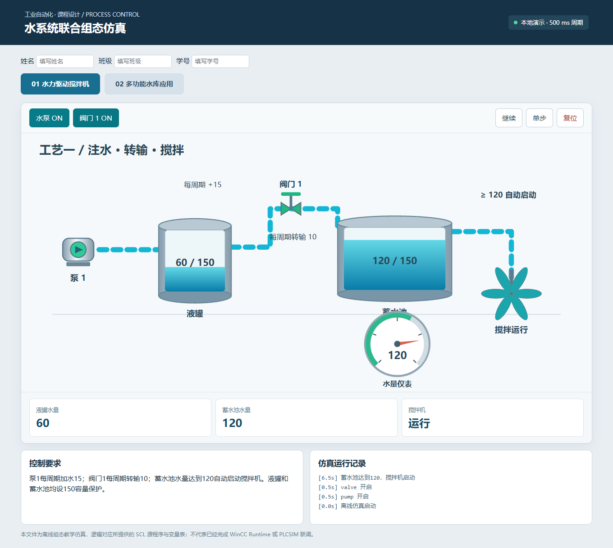

# 自动化仿真实验集

将本机的自动化教学项目整理成可阅读、可导入的源码。包含 TIA Portal V17 的 PLC/HMI 逻辑，以及 8051、74HC595 和 RS-485 教学实验。所有案例面向仿真与学习。

[打开水系统网页仿真](https://yangwei251003.github.io/automation-simulation-labs/plc/water/WaterSimulation.html)

| 目录 | 内容 | 入口 |
|---|---|---|
| plc/water | 水池搅拌、水库装车、液位与阀门状态 | WaterSimulation.html、WaterControl.scl、HMI XML |
| plc/traffic-lights | 启停、东西与南北交替通行、定时相位 | Main.xml、TrafficTimers.xml、PlcTags.xml |
| plc/sequenced-lights | 定时驱动的流水灯程序与 HMI | Main.xml、Timers.xml、Screen.xml |
| plc/frame-counters | 由 PLC 定时器驱动的双路帧号及风扇图形 | Main.xml、AnimationTimer.xml |
| mcu/greenhouse | 小型温室 LCD 与控制逻辑 | main.c、main.hex |
| mcu/motor-pwm | 直流电机 PWM 调速 | main.c、main.hex |
| mcu/heart-matrix | 8051、74HC595 和 8×8 爱心点阵 | main.c、heart.hex |
| mcu/rs485 | 8051 三节点固件与第九位寻址、校验、离线重试模型 | protocol_model.py、master、slave1、slave2 |

## 使用

水系统浏览器演示可直接打开 HTML。其状态机用于教学展示，速度和液位是仿真量。

TIA Portal V17 中可在匹配的 PLC/HMI 工程下导入 SCL 和 Openness XML。建议先放入数据块/定时器与标签，后导入程序块，最后导入 HMI 图形、标签和画面，再检查连接和完整编译。文档 [TIA 导入次序](docs/tia-import.md) 标明哪些文件一起使用。运行软件和设备框架依赖西门子授权，仿真实验应在孤立环境完成。

8051 的 C 源码使用 Keil C51 语法和器件头文件。目录中含仿真用 HEX；在 Proteus 中设置芯片与固件路径后启动，若工程指向旧位置需重新选择对应 HEX。使用 RS-485 功能模型：

    python mcu/rs485/protocol_model.py

该模型验证功能状态、校验和和离线重试。三节点电气级联合仿真尚未通过。

## 许可

原创程序、仿真和文档采用 [MIT](LICENSE)。TIA Portal、WinCC、Proteus、Keil 与芯片库遵循各自提供方的许可。
